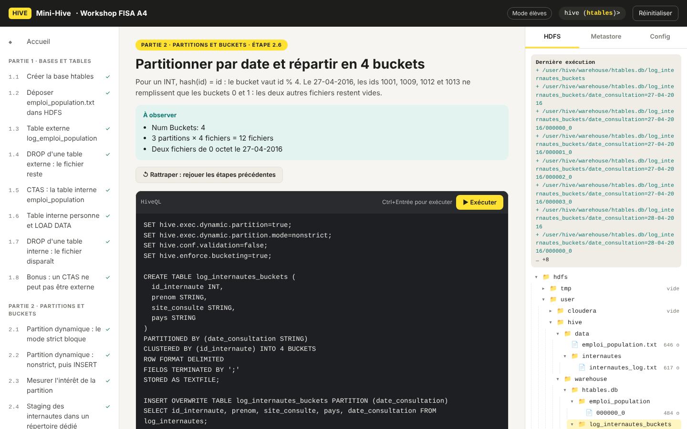

# Mini-Hive · le workshop Hive sans Hadoop

Un seul fichier Python pour pratiquer Apache Hive sans machine virtuelle Cloudera. Il suffit de Python 3.8 ou plus récent : aucune dépendance n'est nécessaire, la bibliothèque standard suffit.

Le script rejoue un workshop d'initiation à Hive (bases et tables, partitions et buckets, analyse de données) et propose une interface web locale.



## Démarrer

```bash
python3 hive_workshop.py            # ouvre l'interface sur http://localhost:8765
```

Les fichiers de données du workshop sont dans `donnees/` : le script les trouve tout seul. Pour en utiliser d'autres : `--donnees CHEMIN`. Les fichiers :

| Fichier | Contenu | Séparateur | En-tête |
|---|---|---|---|
| `emploi_population.txt` | genre ; date de naissance ; fonction ; salaire ; code postal ; id | `;` | non |
| `personne.txt` | id ; nom ; prénom | `;` | non |
| `internautes_log.txt` | id ; prénom ; site ; date (JJ-MM-AAAA) ; pays | `;` | non |
| `employes.txt` | id_empl ; nom ; prénom ; date de naissance | `;` | non |
| `fonction_employes.txt` | id_empl ; année d'embauche ; fonction | `;` | oui |
| `salaire_employes.txt` | sexe ; secteur ; salaire (`20000euro/an`) ; code postal ; id_empl | `;` | oui |

Les fichiers ont des fins de ligne Windows (CRLF) et quelques accents en Latin-1, que Hive affiche « � » : c'est voulu, le script reproduit ce comportement.

## L'interface web

Le fichier [`interface/index.html`](interface/index.html) contient toute l'interface : HTML, CSS et JavaScript, sans dépendance externe. Le script le sert sur http://localhost:8765 et le relit à chaque chargement de page. On peut donc le modifier et voir le résultat en rafraîchissant le navigateur. Si le dossier `interface/` est absent, le script utilise la copie intégrée dans `hive_workshop.py` : le script seul reste autonome.

Chaque lancement de l'interface repart de zéro, pour que les étapes s'exécutent dans l'ordre sans tomber sur des objets créés lors d'une séance précédente. Comme `hive -f`, un bloc s'arrête à la première erreur. Si une étape échoue avec « already exists » ou « File exists », c'est qu'elle a déjà été exécutée : l'interface propose alors « Tout réinitialiser » ou « Rattraper jusqu'ici ».

## Commandes

| Commande | Effet |
|---|---|
| `python3 hive_workshop.py` | Interface web, en repartant d'un HDFS et d'un Metastore vides |
| `python3 hive_workshop.py serve --conserver` | Interface web, en reprenant l'état et la base courante du lancement précédent |
| `python3 hive_workshop.py rejouer` | Rejoue toutes les étapes dans le terminal |
| `python3 hive_workshop.py console` | Invite `hive>` interactive, comme le Hive CLI |
| `python3 hive_workshop.py sql "SHOW DATABASES;"` | Exécute des instructions puis quitte |
| `python3 hive_workshop.py verifier` | Contrôles automatiques sur les données |
| `python3 hive_workshop.py reset` | Vide le HDFS simulé et le Metastore |

## Ce qui est simulé

- **HDFS** : un vrai dossier, `mini_hdfs/hdfs/`, où l'on voit apparaître les répertoires de partitions et les fichiers de buckets. Commandes prises en charge : `hdfs dfs` et `hadoop fs` avec `-ls [-R]`, `-mkdir [-p]`, `-copyFromLocal`, `-put`, `-cat`, `-rm [-r]`, `-mv`, `-cp`, `-du`, `-chmod`. Les chemins locaux de la VM (`/home/cloudera/…`) sont cherchés dans `donnees/`.
- **Metastore** : un fichier JSON.
- **HiveQL** :
  - Définition : `CREATE DATABASE`, `CREATE [EXTERNAL] TABLE` (avec `LOCATION`, `PARTITIONED BY`, `CLUSTERED BY … INTO n BUCKETS`, `skip.header.line.count`), CTAS, `CREATE VIEW`, `DROP`.
  - Données : `LOAD DATA`, `INSERT OVERWRITE|INTO … PARTITION`, `SET`.
  - Consultation : `DESCRIBE [FORMATTED]`, `SHOW PARTITIONS`, `SHOW TBLPROPERTIES`.
  - Requêtes : `SELECT` avec jointures, vues, `GROUP BY`, `CASE WHEN`, `corr()`, `COLLECT_SET`, `REGEXP_REPLACE` et `INPUT__FILE__NAME`.
- **Comportements de Hive 1.1 reproduits** :
  - Un `CAST` raté renvoie `NULL`.
  - `/` renvoie toujours un nombre décimal.
  - Les colonnes manquantes valent `NULL`.
  - `LOAD DATA INPATH` déplace le fichier.
  - Supprimer une table interne efface ses données ; une table externe les garde.
  - CTAS externe refusé (Error 10070).
  - Mode strict des partitions dynamiques (Error 10096).
  - Buckets par `hash % N`, avec des fichiers vides.
  - Sans `hive.enforce.bucketing`, un seul fichier.
  - Erreur « Not a file » quand un répertoire `LOCATION` contient un sous-répertoire.

Les requêtes sont traduites puis exécutées par SQLite. La distribution, MapReduce, YARN et les temps de réponse ne sont pas simulés. Pour chaque `SELECT`, le script indique combien de fichiers Hive lirait, y compris quand des partitions sont éliminées.

## Corrections

`corriges.py` contient les solutions, le corrigé d'origine du sujet (2023), les résultats attendus et une version en Python pur de chaque question. Quand il est présent à côté du script, l'interface est en mode tuteur. Pour une version élèves :

```bash
python3 hive_workshop.py serve --sans-corriges
```

Pour qu'il n'y ait vraiment aucune réponse, distribuez `hive_workshop.py` sans `corriges.py`.
